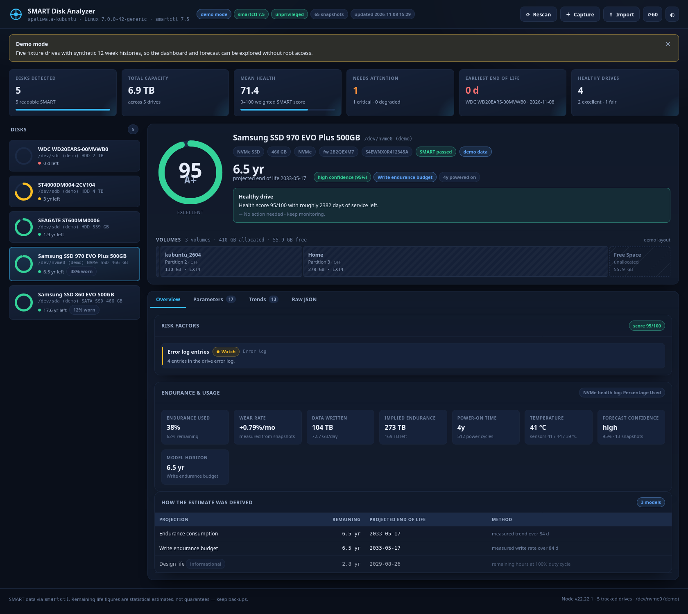
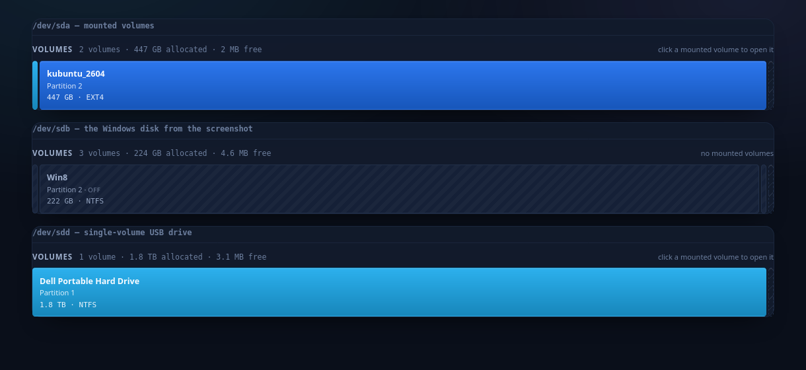

# SMART Disk Analyzer

**Know how long each drive will last.** The dashboard reads **every SMART parameter of every disk
in the machine**, scores the health of each drive, **forecasts its remaining useful life** with an
explicit confidence level and draws the partition layout.

`smartctl` (from `smartmontools`) is the only part that talks to the hardware. Everything else runs
on your machine: a tiny zero-dependency Node process serves a vanilla-JavaScript single page app
built from web components, on Linux, macOS and Windows.



## Highlights

- **All parameters, not a summary** – every ATA attribute, every NVMe health-log field and
  every SCSI counter is normalised into one sortable, searchable, filterable table with a
  plain-English explanation per row, severity rating and CSV export.
- **Remaining-life forecast** – five independent projections (measured wear trend,
  write-endurance budget, media-defect growth, health-score decay, health-weighted design
  life) are combined into one estimate with an explicit confidence level and a breakdown of
  which model produced the answer.
- **History and trends** – snapshots are stored on disk, charted with a canvas trend chart
  and used to replace lifetime averages with *measured* wear and write rates.
- **Volume map with one-click access** – the hero panel draws the drive's partitions as a
  proportional bar (label, partition number, size, filesystem, mounted or not, unallocated
  tail); clicking a mounted volume opens it in the desktop's file manager.
- **Works without root** – disks are still listed, each one explains why it cannot be read,
  and you can drop a `smartctl -a -j` JSON file from any machine onto the page to analyse
  it. Demo mode ships five fixture drives so the whole UI can be explored immediately.
- **Zero runtime dependencies** – no npm packages, no build step, no telemetry. Everything
  runs on your machine.

## Quick start

```bash
# 1. smartmontools must be installed
sudo apt install smartmontools        # Debian / Ubuntu
# sudo dnf install smartmontools      # Fedora
# brew install smartmontools          # macOS

# 2. Explore the UI with bundled demo drives (no root needed)
npm run demo
# → http://127.0.0.1:7373

# 3. Read the real disks (SMART needs raw device access)
sudo npm start
# or, nicer: elevate only smartctl, not the whole server
sudo ./bin/setup-sudoers.sh     # once
npm run elevated
```

Requires Node.js ≥ 18.13 (tested on Node 22). <kbd>Ctrl</kbd>+<kbd>C</kbd> stops the server;
[Windows](#windows) has its own launcher, and [Running and stopping](#running-and-stopping-the-server)
plus [Permissions](#permissions) cover the details.

### Windows

The dashboard runs on Windows, but raw disk access is restricted to administrators:

```powershell
winget install smartmontools      # or the installer from smartmontools.org
```

1. **smartmontools must be installed** — the device list comes from `smartctl --scan`. The
   Windows installer does not always add `bin` to `PATH`, so the analyzer probes
   `C:\Program Files\smartmontools\bin` (and the `x86` equivalent) itself. For any other
   location, pass it: `npm start -- --smartctl "D:\tools\smartctl.exe"`.
2. **Start the server from an elevated terminal** (*Run as administrator*) — Windows only lets
   administrators read raw disk data. There is no `sudo` or sudoers step on Windows.

The easiest way to satisfy both is the bundled launcher: it finds `node.exe` even when `PATH`
is stale, adds `smartmontools\bin` to the server's own `PATH`, and asks for elevation itself.

```powershell
bin\run-windows.cmd                                   # double-clickable
powershell -ExecutionPolicy Bypass -File bin\run-windows.ps1 -Port 8080 -NoBrowser
```

Or start it by hand from an Administrator PowerShell:

```powershell
npm start
```

Installing smartmontools while the server is running is enough: detection repeats while no
binary is found, so a **Rescan** picks it up without a restart.

The Volumes bar works on Windows too: disks, partitions and drive letters come from the Storage
cmdlets (`Get-Disk`, `Get-Partition`, `Get-Volume`), so `C:` and friends are drawn on their own
physical drive with their label, filesystem, size and free space — exactly like the `lsblk` map
on Linux. Bare partitions (EFI, MSR, Recovery) appear as unmounted segments, and clicking a
lettered volume opens it in Explorer. If the cmdlets are blocked, the bar is simply empty and
`/api/partitions` reports why.

To fix `PATH` permanently instead, run this once in an **elevated** PowerShell:

```powershell
$machine = [Environment]::GetEnvironmentVariable('Path', 'Machine')
if ($machine -notlike '*smartmontools*') {
  [Environment]::SetEnvironmentVariable('Path', ($machine.TrimEnd(';') + ';C:\Program Files\smartmontools\bin'), 'Machine')
}
```

If no disk is listed, the dashboard banner states exactly which of these steps is missing.

## Running and stopping the server

The analyzer is a foreground process: it starts, prints its URL, and keeps running.

| | Start | Stop |
| --- | --- | --- |
| Linux / macOS | `npm start` · `sudo npm start` · `npm run elevated` | <kbd>Ctrl</kbd>+<kbd>C</kbd> |
| Windows | `bin\run-windows.cmd` (asks for elevation) | <kbd>Ctrl</kbd>+<kbd>C</kbd> in that window |
| Demo mode | `npm run demo` | <kbd>Ctrl</kbd>+<kbd>C</kbd> |

```bash
npm start                        # live SMART data, opens the dashboard in your browser
npm start -- --port 8080         # a different port (default 7373, also PORT=8080)
npm start -- --no-browser        # headless / server use
curl -s localhost:7373/api/status | head -c 200    # is it alive?
```

- **Closing the browser does not stop the server.** It listens on `127.0.0.1` only and keeps
  answering until you stop the process.
- **`EADDRINUSE` on start** means another instance owns the port: stop it, or pass `--port`.
- **Left it running in the background?** `nohup npm start > smart.log 2>&1 &` starts it and
  `pkill -f "server/index.js"` stops it. On Windows, find the listener and stop it by PID:

  ```powershell
  netstat -ano | findstr :7373
  Stop-Process -Id <pid>
  ```

- **`--no-browser` is implied** when stdout is not a terminal (services, CI, `nohup`).
- Snapshots live in `data/history.json` (or `--history-file`); stopping the server never loses
  them, and six-hourly auto-capture resumes on the next start.

## Permissions

SMART data is raw hardware access, which every desktop OS restricts. Nothing else in the
application needs privileges: the HTTP API binds `127.0.0.1` only, sends no CORS headers, and
`POST /api/open` only opens a mount point that the volume scan actually reported.

| Platform | Needs | How | Without it |
| --- | --- | --- | --- |
| Linux | root, or `CAP_SYS_RAWIO` | `sudo npm start`, or `sudo ./bin/setup-sudoers.sh` once then `npm run elevated` | drives are still listed, every SMART read fails with `Permission denied`, and the banner says so |
| macOS | root | `sudo npm start` | same |
| Windows | Administrator | `bin\run-windows.cmd` (UAC prompt) or an elevated PowerShell | same — `smartctl --scan` still enumerates drives, but reading them is denied |

- Elevating the **server** is what grants device access; a browser cannot obtain it.
- `npm run elevated` sends only `smartctl` through `sudo -n`; the server itself stays unprivileged.
- Demo mode and importing a `smartctl -a -j` file need **no** privileges at all — useful on a
  locked-down machine.
- The process never asks for credentials, never writes outside its history file, and never opens
  a path that was not reported as a mount point.

## How it works

```
┌──────────────────────────────┐        ┌───────────────────────────────┐
│ Browser (public/)            │  HTTP  │ Node server (server/)         │
│  web components, canvas      │ <────> │  scan devices, run smartctl   │
│  charts, attribute tables    │  JSON  │  persist snapshot history     │
└──────────────┬───────────────┘        └──────────────┬────────────────┘
               │ imports                                │ imports
               └──────────────► shared/ ◄───────────────┘
                 normalisation, attribute knowledge base, health + RUL model
```

`shared/` is pure ES modules with no Node or DOM APIs, so the *same* analysis code runs in
both places. That is why imported JSON files get identical scores to locally scanned disks.

| Path | Purpose |
| --- | --- |
| `shared/attributes.js` | ATA/NVMe/SCSI attribute dictionary + severity rules |
| `shared/normalize.js` | `smartctl -a -j` JSON → one unified device model |
| `shared/forecast.js` | Health scoring, trend regression, RUL projections |
| `shared/format.js` | Byte / duration / percent formatting helpers |
| `shared/diagnose.js` | Plain-language diagnosis when no disk can be listed (missing smartctl, empty scan, missing privileges) |
| `server/smartctl.js` | Device discovery and `smartctl` execution |
| `server/partitions.js` | Volume map (`lsblk`/`findmnt`, Windows Storage cmdlets) and the file-manager launcher |
| `server/store.js` | Atomic JSON snapshot history |
| `server/demo.js` | Fixture loader + synthetic history generator |
| `server/index.js` | HTTP API + static hosting |
| `bin/run-elevated.sh` · `bin/setup-sudoers.sh` | Linux: run `smartctl` elevated, or grant it `CAP_SYS_RAWIO` once |
| `bin/run-windows.ps1` · `bin/run-windows.cmd` | Windows launcher: finds `node.exe`, adds `smartmontools\bin` to the server's `PATH`, asks for elevation |
| `public/js/components/` | `<sa-gauge>`, `<sa-disk-list>`, `<sa-partition-map>`, `<sa-attribute-table>`, `<sa-trend-chart>`, `<sa-forecast-panel>`, `<sa-risk-list>`, `<sa-kpi-strip>`, `<sa-import-dialog>`, `<sa-toasts>` |

## Remaining-life model

For each disk the engine computes several independent projections and takes the most
pessimistic one, then applies safety caps:

1. **Endurance consumption** – remaining endurance (`100 − percentage_used`, or the
   countdown normalised ATA gauges 202/231/233/177) divided by the wear rate. The rate is
   the slope of a least-squares fit over the stored snapshots when at least one day of
   history exists, otherwise the lifetime average (`wear ÷ power-on days`).
2. **Write endurance budget** – the implied rated TBW is derived from the drive itself
   (`bytes written ÷ wear fraction`), then remaining bytes are divided by the measured or
   average write rate. A 970 EVO Plus at 38 % used with 114 TB written correctly implies a
   300 TB rating.
3. **Media defect growth** – linear extrapolation of reallocated / pending sector counts to
   the practical red line (100 reallocated or 10 pending sectors).
4. **Health score decay** – extrapolation of the health score to the replacement threshold
   of 40.
5. **Design life** – remaining powered-on hours against a nominal 43 800 h budget, scaled
   by health (0.6×–1.4×) and converted with the measured duty cycle. A drive past its
   budget gets a health-proportional grace period instead of a hard zero.

Safety caps stop the model from being optimistic: a failing SMART status caps the estimate
at 30 days, pending sectors at 60 days, any critical risk factor at 180 days, and the health
score itself imposes a ceiling (score < 45 → 180 d, < 60 → 365 d, < 70 → 730 d, < 85 → 1095 d).

**Confidence** starts at 20 % and grows with firmware-reported wear data (+30 %), history
depth (+25 % for ≥ 3 snapshots over ≥ 7 days, +12 % for ≥ 30 days), agreement between
independent models (+8 %), and shrinks for missing gauges and open critical risks. Every
number is labelled `low` / `medium` / `high`, and the UI shows the individual projections so
the estimate is never a black box.

The health score starts at 100 and subtracts weighted penalties for reallocated sectors,
pending/uncorrectable sectors, media errors, self-test failures, endurance consumed,
critical warnings, spare-block exhaustion, temperature, interface CRC errors, age and
unfavourable trends. The full penalty list is returned by the API.


## Using the dashboard

| Area | What you get |
| --- | --- |
| KPI strip | disk count, total capacity, mean health, drives needing attention, earliest end of life |
| Disk rail | every drive with a compact health ring, capacity, wear and remaining life; sorted worst first |
| Hero | health gauge with grade, remaining life, projected failure date, confidence and a concrete recommendation |
| Volumes bar | the drive's partitions as one proportional bar with label, partition number, size, filesystem, mounted state and unallocated space; mounted volumes open in the file manager when clicked |
| Overview tab | risk factors with severity and the SMART attribute that triggered them, endurance/usage stats, and the model breakdown |
| Parameters tab | all parameters: search, category chips, severity filters, sortable columns, expandable explanation per row, CSV export |
| Trends tab | canvas trend chart (endurance, health, temperature, reallocated, pending, bytes written, power-on hours) with hover readout and the recent snapshot table |
| Raw JSON tab | the untouched `smartctl` JSON with copy and download |

Keyboard: `R` rescan · `C` capture snapshot · `I` import JSON · `?` shortcut help.

**Capture** stores a snapshot of every readable disk. Snapshots older than six hours are
also captured automatically on every scan, so trends build up by themselves if the analyzer
is left running (or launched from a timer). A few days of history is enough for the model to
switch from lifetime averages to measured rates.

## Volumes and the file manager



Under the recommendation the hero panel shows the drive's partition layout the way a desktop
disk utility does:

- each partition is a segment whose width is proportional to its size (tiny partitions keep a
  minimum visible width and show their details in the tooltip);
- the label, `Partition n`, size and filesystem are printed inside the segment, plus `off`
  when the volume is not mounted;
- the unallocated tail of the drive is drawn as a dashed **Free Space** segment;
- **clicking a mounted volume** opens that mount point in the default file manager
  (`xdg-open`, `gio open`, `nautilus`, `dolphin`, … on Linux, `open` on macOS, `explorer` on
  Windows). Each segment is a real `file:///…` link, so copy-link and middle-click work too.

A browser cannot launch a file manager itself, so the click becomes a `POST /api/open` to the
local server, which:

1. refuses cross-origin requests (the API sends no CORS headers, so a page on the internet
   cannot drive it),
2. only accepts a path that the volume scan reported as a **mount point** — `..` escapes,
   relative paths and arbitrary paths are rejected before anything is spawned,
3. spawns the launcher with an argument array (never a shell), so a path containing spaces or
   semicolons is inert,
4. drops to `SUDO_USER` when the server runs as root (which it needs for SMART), so the window
   opens in *your* desktop session instead of root's.

Unmounted volumes are deliberately not clickable — there is nothing mounted to open. They are
shown muted with `off` and explain themselves in a toast. `--no-open` (or `ALLOW_OPEN=0`)
disables the feature entirely.

Partition data comes from `lsblk -J`, which includes unmounted partitions and the free tail.
Where `lsblk` is missing or blocked — containers, minimal images — the server falls back to
`findmnt -J`, which can only report mounted filesystems, so the bar then contains just those.

On Windows the same picture is assembled from the Storage cmdlets (`Get-Disk`, `Get-Partition`,
`Get-Volume`): partition → disk numbering matches `PhysicalDriveN`, which is how `smartctl`'s
`/dev/sdX` addresses the drive, so each bar shows the right drive's partitions. Drive letters are
the mount points, so a click opens `C:\` in Explorer. If the cmdlets are blocked (locked-down
policy, no permission) the map degrades to empty and `/api/partitions` reports the reason.

Demo drives carry a fabricated layout and are never opened.

## CLI options

```
node server/index.js [options]

  -p, --port <n>              HTTP port (default 7373, env PORT)
      --host <addr>           bind address (default 127.0.0.1, env HOST)
      --demo                  use the bundled fixtures + synthetic history
      --live                  force live smartctl reads (default)
      --sudo                  run smartctl through "sudo -n"
      --smartctl <path>       smartctl binary (default "smartctl")
      --refresh <seconds>     device scan cache TTL (default 30)
      --capture-interval <h>  minimum hours between automatic snapshots (default 6)
      --design-life <hours>   design life used by the age model (default 43800)
      --no-auto-capture       never write snapshots automatically
      --no-open               do not let the GUI open a volume in the file manager
      --no-browser            do not open the dashboard in a browser on start
      --history-file <path>   where snapshots are stored (default ./data/history.json)
      --lsblk <path>          lsblk binary used for the partition map (default "lsblk")
      --verbose               log every request
```

Environment equivalents: `PORT`, `HOST`, `SMART_MODE=demo`, `SMARTCTL_BIN`,
`SMARTCTL_SUDO=1`, `REFRESH_SECONDS`, `CAPTURE_INTERVAL_HOURS`, `DESIGN_LIFE_HOURS`,
`AUTO_CAPTURE=0`, `ALLOW_OPEN=0`, `NO_BROWSER=1`, `LSBLK_BIN`, `FINDMNT_BIN`, `HISTORY_FILE`.

Every interactive start (`npm start`, `npm run demo`, `npm run elevated`) opens the dashboard
in your default browser once the server is listening; `--no-browser` (or `NO_BROWSER=1`)
disables that, and it is skipped automatically when there is no terminal (services, CI).
<kbd>Ctrl</kbd>+<kbd>C</kbd> stops the server in every case; see
[Running and stopping](#running-and-stopping-the-server) and [Permissions](#permissions).

## HTTP API

| Method | Route | Description |
| --- | --- | --- |
| GET | `/api/disks` | all disks with attributes, health and forecast (`?refresh=1` bypasses the scan cache) |
| GET | `/api/disks/:key` | one disk |
| GET | `/api/status` | smartctl version, privileges, host info, history summary |
| POST | `/api/capture` | store a snapshot for every readable disk |
| GET | `/api/history/:key` | snapshot history of one disk |
| DELETE | `/api/history/:key` | forget the history of one disk |
| POST | `/api/import` | analyse `smartctl` JSON posted in the request body |
| GET | `/api/partitions` | raw volume map (`lsblk`/`findmnt`/Windows cmdlets), mount allowlist and launcher status |
| POST | `/api/open` | open a **mount point** in the desktop file manager (`{"path": "/run/media/…"}`) |
| GET | `/api/download/:key` | download the raw `smartctl` JSON |

Example:

```bash
curl -s localhost:7373/api/disks | jq '.disks[] | {model, score: .health.score, rulDays: .forecast.rul.days}'
```

## Reading other machines' disks

```bash
sudo smartctl -a -j /dev/sda > disk.json     # on the remote machine
```

Drop `disk.json` onto the dashboard (or use **Import**). Parsing, scoring and forecasting
run in the browser with the same shared modules - the server is not involved.

## Development

```bash
npm start        # live mode
npm run dev      # live mode with --watch
npm run demo     # fixtures + synthetic history
npm test         # normalisation, attribute rules, forecast model, API and store tests
```

Everything is plain ES modules; there is no bundler. Edit a file and reload the page.

## Notes and limitations

- The forecast is a statistical estimate, not a guarantee: SMART indicators precede most but
  not all failures (and a drive can die without any warning). Keep backups.
- `smartctl` needs root (or CAP_SYS_RAWIO) for raw device access; that is a kernel
  permission, not something a browser can work around. Per-platform requirements are in
  [Permissions](#permissions).
- ATA attributes are vendor specific. Known IDs are documented in `shared/attributes.js`;
  unknown ones get a generic trend explanation instead of a guessed verdict.
- Some USB bridges and RAID controllers hide SMART data entirely. Pass the right `-d` device
  type; the server forwards any non-standard type reported by the scan, while ATA, SCSI and
  NVMe are auto-detected.
- `smartctl` sometimes lists one drive more than once — under two `-d` types on Windows, or as
  both a physical disk and a RAID member. Duplicates are collapsed by device path and then by
  serial number, so every drive appears exactly once; drives without a readable serial are
  never merged, because they really can be two identical models.
- Remaining-life figures assume the recent workload continues. A drive that suddenly gets
  much more write traffic will age faster than the projection.
- The volume map mirrors the host: partitions are discovered with `lsblk` (or the Windows Storage
  cmdlets), so on a machine where `lsblk` is unavailable only mounted filesystems (`findmnt`) are
  shown. Opening a volume needs a desktop session — on a headless box the request reports
  `xdg-open exited with code …` instead of silently doing nothing.

## License

MIT
